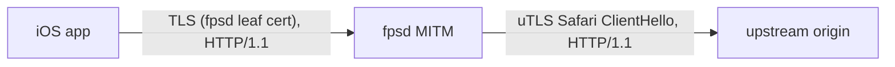

# Spec 026: Browser-Shaped Upstream TLS ClientHello for MITM Sessions

**Status**: COMPLETE
**Created**: 2026-11-12
**Depends on**: Spec 006 (MITM TLS interception)

> **Note**: This work has no associated issue tracker ticket. Consider creating one for traceability.

---

## Problem Statement

Since at least 2026-11-12, the Reddit iOS app stops working when `gql-fed.reddit.com` is intercepted. Every logged-in GraphQL request that `fpsd` re-originates upstream receives an HTTP 403 with Reddit's "blocked by network security" HTML page (Varnish, ~190 KB). With `gql-fed.reddit.com` removed from `mitm.domains`, the same app on the same network and public IP works.

The cause was isolated by A/B testing against the live app, one variable at a time:

| Variant (upstream connection from `fpsd`) | Result |
|---|---|
| Go `crypto/tls`, `Accept-Encoding` stripped, headers re-serialized (v1.5.2 behavior) | 403 |
| Go `crypto/tls`, client `Accept-Encoding` forwarded | 403 (30 of 38) |
| Go `crypto/tls`, request head forwarded byte-for-byte | 403 (15 of 17), identical to re-serialized |
| uTLS Safari ClientHello, ALPN `http/1.1`, either header mode | 200 (75 of 75) |
| No MITM (app connects directly) | works |

Header content, header order, and HTTP/1.1 are not the trigger. Reddit's edge rejects logged-in traffic whose TLS ClientHello is Go's `crypto/tls` fingerprint. Unauthenticated requests over the same Go fingerprint return 401 (not 403), so logged-out probes do not reproduce the block.

The Go ClientHello is a stable, widely fingerprinted signature. Any other intercepted site can apply the same rule, so the fix belongs in the MITM upstream path, not in a Reddit plugin.

---

## Approach

Replace the upstream TLS client in `internal/mitm` with a uTLS (`github.com/refraction-networking/utls`) client that sends a Safari-shaped ClientHello. The proxy loop speaks HTTP/1.1 to upstream, so the ALPN extension (and ALPS, if present in the preset) is narrowed to `http/1.1`. Certificate verification is unchanged: uTLS performs standard verification against the system roots with `ServerName` set to the intercepted domain.

The fingerprint is selected by a new config key, which also serves as the rollback lever:

```yaml
mitm:
  upstream_tls: "safari"   # "safari" (default) or "go"
```

- `safari`: uTLS `HelloSafari_Auto` with ALPN narrowed to `http/1.1`.
- `go`: Go `crypto/tls`, the v1.5.2 behavior.



---

## Scope

### In Scope

- `mitm.upstream_tls` config key with validation (`safari`, `go`; empty means `safari`).
- uTLS-based upstream handshake in `internal/mitm`, selected per the config key.
- Logging of the active fingerprint at startup and in upstream handshake failure logs.
- `fpsd.yml` example and README documentation.

### Out of Scope

- HTTP/2 to upstream or to the client. Tested as unnecessary for the Reddit block.
- Automatic fallback from `safari` to `go` on handshake failure (see Alternatives).
- Per-domain fingerprint selection.
- Header handling changes. `Accept-Encoding` stripping stays (required by response modifiers and proven irrelevant to the block).

---

## Design

### Package Structure

| File | Change |
|---|---|
| `internal/mitm/upstream.go` (new) | `upstreamTLSConn` interface; `newUpstreamTLS(conn, domain, fingerprint, rootCAs)` returning a `crypto/tls` or uTLS client. |
| `internal/mitm/handler.go` | `Handle` uses `newUpstreamTLS`; `proxyLoop` takes `net.Conn` for the upstream side. `InterceptorConfig.UpstreamTLS` field. |
| `internal/config/config.go` | `MITM.UpstreamTLS`, default `safari`, validation. |
| `cmd/fpsd/main.go` | Pass `cfg.MITM.UpstreamTLS` to the interceptor; log it at startup. |

### Fingerprint constants

```go
const (
    UpstreamTLSSafari = "safari"
    UpstreamTLSGo     = "go"
)
```

---

## Test Strategy

### Automated (Go tests)

Unit and loopback-integration tests in `internal/mitm` and `internal/config`:

- **ClientHello shape (loopback TLS server)**: a local TLS server records the received `tls.ClientHelloInfo`. With `safari`, the hello carries a GREASE cipher suite value and ALPN exactly `["http/1.1"]`. With `go`, no GREASE value is present. This asserts the observable property the upstream sees, not internal uTLS calls.
- **End-to-end through `Handle`**: a real `Handle` session against a loopback HTTPS origin, for both fingerprints. The client sends a request through the MITM tunnel and receives the origin's response. Upstream certificate verification runs against a test root pool, not skipped.
- **Verification is enforced**: with `safari`, an upstream whose certificate does not chain to the trusted roots fails the handshake and the client receives no response.
- **Config validation**: `safari`, `go`, and empty are accepted; other values are rejected; the default is `safari`.

### Manual / Live Verification (integration boundary)

The real downstream system is Reddit's edge. Covered by the E2E Test Plan below.

---

## Acceptance Criteria

- [x] `mitm.upstream_tls` accepts `safari` and `go`, defaults to `safari` when unset, and rejects other values at config validation.
- [x] With `safari`, the upstream ClientHello contains a GREASE cipher suite and offers ALPN `http/1.1` only (loopback test).
- [x] With `go`, the upstream ClientHello is Go's `crypto/tls` hello (no GREASE) (loopback test).
- [x] A full `Handle` session proxies a request and response through a loopback origin for both fingerprints, with upstream certificate verification enabled.
- [x] With `safari`, an upstream certificate that does not verify causes the handshake to fail (no response is proxied).
- [x] The active fingerprint is logged at startup; upstream handshake failures log the fingerprint.
- [x] Live: with v1.5.3 installed and `gql-fed.reddit.com` intercepted, the logged-in Reddit iOS app loads its home feed (no 403 "blocked by network security"), and `reddit-promotions` filter matches appear in the fpsd log for that session.
- [x] `fpsd.yml` example and README document `mitm.upstream_tls`; README changelog has a 1.5.3 entry; Makefile `VERSION` and PKGBUILD `pkgver` are 1.5.3.
- [x] `make test`, `make lint`, and `go vet ./...` pass.

---

## E2E Test Plan

| Step | Environment | Action | Expected result | AC |
|---|---|---|---|---|
| 1 | njv-cachyos, fpsd v1.5.3 from the release, default config (`upstream_tls` unset) | `fpsd version`; check startup log | Version 1.5.3; startup log shows `upstream_tls=safari` | 1, 6 |
| 2 | Same; `gql-fed.reddit.com` in `mitm.domains` and plugin domain lists | Force-quit the Reddit iOS app, reopen, pull to refresh the home feed | Feed loads; no "blocked by network security" page | 7 |
| 3 | Same | Inspect fpsd log for the session window | `transparent mitm` sessions for `gql-fed.reddit.com` from the phone; `plugin filter match` entries from `reddit-promotions` | 7 |

### Prod visibility

Not applicable: single-host personal deployment. Observation is through the fpsd log (`~/.local/share/fpsd/logs/fpsd.log`) and the dashboard.

---

## Risks & Assumptions

- **Rollback**: set `mitm.upstream_tls: "go"` and restart (restores v1.5.2 upstream behavior), or reinstall v1.5.2.
- **Preset staleness**: uTLS's Safari preset ages as Safari changes. If an origin starts rejecting it, the symptom is a 403 or handshake failure on intercepted domains; the log line carries the fingerprint for diagnosis, and `go` remains available.
- **ALPN deviation**: narrowing ALPN to `http/1.1` makes the hello differ from a real Safari hello (which offers `h2`). Verified acceptable for Reddit; JA3 does not include ALPN, JA4 does.
- **New dependency**: `refraction-networking/utls` (plus `klauspost/compress`, `golang.org/x/crypto` transitively) is security-sensitive TLS code. Pinned in `go.mod`; covered by `govulncheck`.
- **Certificate verification**: uTLS uses its fork of `crypto/tls` verification. The verification-enforced test guards against a configuration that disables it.
- **TLS versions**: the Safari preset offers TLS 1.0 through 1.3, as Safari does; the Go path required TLS 1.2+. A server that negotiates below 1.2 is accepted with `safari`. Modern origins negotiate 1.3.
- **Assumption**: other currently intercepted domains (`www.reddit.com`, `old.reddit.com`) accept the Safari hello. Checked during the experiment (`www.reddit.com` returned 200).

---

## Alternatives Considered

- Considered forwarding headers verbatim or keeping `Accept-Encoding`; rejected because A/B tests showed no effect on the block.
- Considered HTTP/2 upstream; rejected because the Safari hello over HTTP/1.1 was sufficient and HTTP/2 would require reworking the proxy loop.
- Considered automatic fallback to Go TLS on uTLS handshake failure; rejected because it would hide fingerprint staleness and the failure mode of interest (a 403 after a successful handshake) would not trigger it. The config key is the explicit rollback.
- Considered the iOS preset (`HelloIOS_Auto`); rejected because uTLS's iOS preset tracks iOS 14, while the Safari 16 preset is closer to current Apple stacks and was the variant verified live.

---

## Executive Summary

MITM upstream connections now send a Safari-shaped TLS ClientHello (uTLS) by default, because Reddit's edge blocks logged-in app traffic re-originated with Go's `crypto/tls` hello; live A/B tests ruled out headers, HTTP version and the public IP. The new `mitm.upstream_tls` key (`safari`/`go`) is the rollback lever. Review first: `internal/mitm/upstream.go` (ALPN narrowing, certificate verification left at defaults) and the verification-enforced test in `upstream_test.go`.

### E2E results (2026-11-12, njv-cachyos, v1.5.3 built from the branch)

| Step | Result |
|---|---|
| 1 | `fpsd 1.5.3`; startup log `mitm enabled ... upstream_tls=safari` with `upstream_tls` unset in the live config. PASS |
| 2 | Reddit iOS app cold start + refresh: home feed loads, no block page. PASS |
| 3 | 31 `gql-fed.reddit.com` MITM sessions, no upstream handshake or read errors; `reddit-promotions` matches: feed-details-ad 7, feed-sdui-ad 1, pdp-comments-ad 2. PASS |
